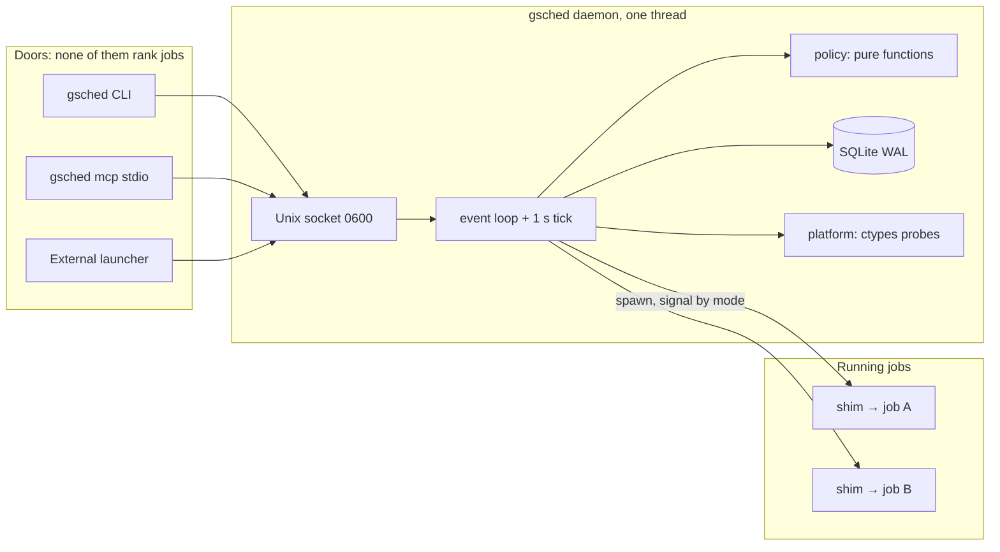
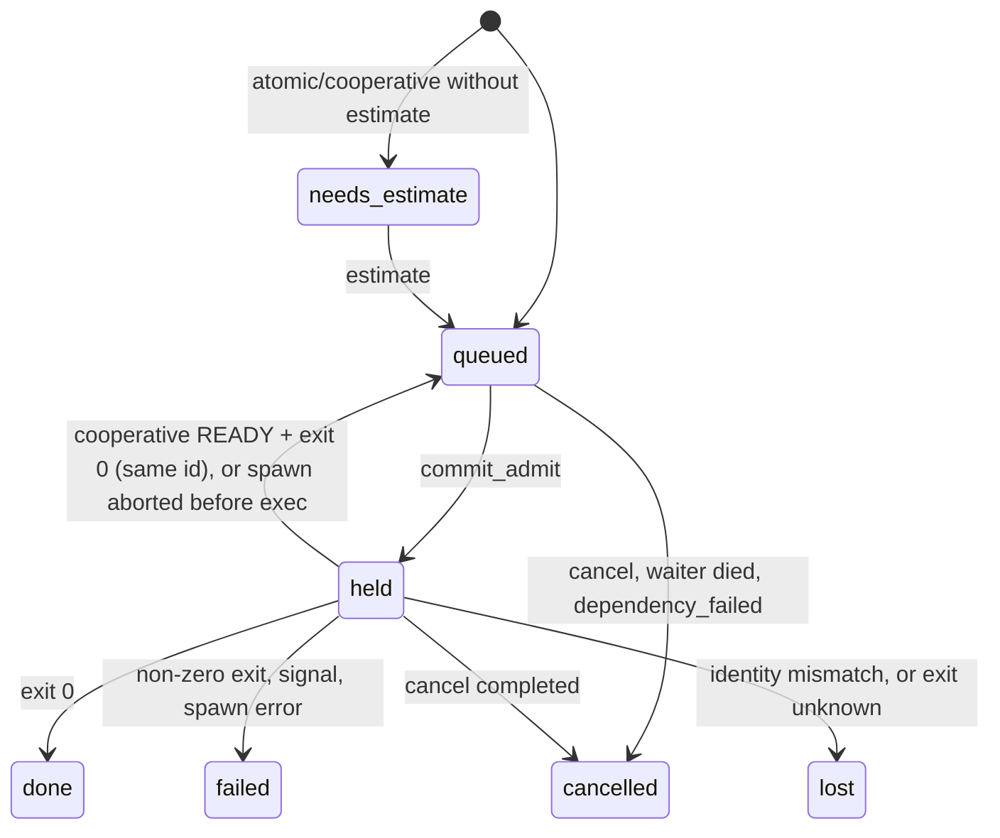

# gpu-scheduler: local admission control for Apple silicon unified memory

| Field | Value |
|---|---|
| Status | Draft v2. Reviewed 2026-11-08. Ready for implementation |
| Audience | People who will build this repo, and anyone running an Apple silicon Mac (Studio, mini, MacBook Pro) for ML experiments |
| Implementation repo | `gpu-scheduler` (GitHub). Empty of code at the time of writing |
| Runtime home | `~/.local/gpu-scheduler`. Override with `GSCHED_HOME` |
| License | Apache-2.0. No CLA |
| Supersedes | The v1 draft of 2026-11-07, archived privately at `docs/local/DESIGN-original-2026-11-07.md`. What changed and why is in [`docs/design-review.md`](docs/design-review.md) |
| How to build it | [`docs/implementation/`](docs/implementation/README.md) |

## 1. Overview

Apple silicon has one unified memory pool shared by the CPU, the GPU (Metal), and the OS. There is no VRAM to partition, no MIG, no MPS. User space also cannot freeze an MLX, PyTorch-MPS, or llama.cpp process and resume it later with its weights still mapped: there is no CRIU for Metal. Two big jobs that both fit on paper can push the machine into swap, and the OS's answer to real memory pressure is jetsam, which kills processes.

`gpu-scheduler` is a small local daemon (`gsched daemon`), a CLI (`gsched`), and an optional MCP stdio adapter (`gsched mcp`). Humans, shell scripts, and LLM-based agents describe a job once, in one versioned JSON document (`gpu-scheduler.job.v1`). The daemon decides **when** each job may start, so that the machine stays busy without going over its memory budget, two GPU-heavy jobs do not fight over the GPU, and a 24-hour training run does not land on the afternoon you wanted for interactive work.

The daemon is not an LLM and has no agent loop. It runs deterministic policy that can be tested with a fake clock. Agents talk to it; it does not talk back to them.

What it does:

- **Packs jobs by memory.** Each job reserves `memory_gib`. Several jobs run at once if their reservations fit the budget **and** the live memory sample agrees.
- **Arbitrates the GPU.** A job declares `gpu: exclusive | shared | none`. One exclusive GPU job at a time, or a few shared ones. CPU-only jobs run beside either.
- **Respects time.** `day` and `night` queues. Long jobs wait for the night window, and a job that cannot be checkpointed does not start in a night too short to finish it.
- **Shares fairly.** Priority first, then weighted fair share between projects, using decayed resource usage.
- **Never invents a checkpoint.** A job declares one of three modes: `restartable`, `cooperative`, or `atomic`. The daemon only stops or signals a job in the ways its mode allows. It never signals a process it did not start.
- **Manages RAM under pressure.** When memory gets tight it stops admitting work, unloads restartable residents it owns, and (if enabled) asks cooperative jobs to checkpoint. It never kills atomic work.
- **Is agent-friendly.** One schema for every door. `submit` returns at once. `get` explains why a job is waiting. Logs can be tailed through the CLI and MCP. Waiting happens in a local process (`gsched wait`) and spends no tokens.

## 2. Background

### 2.1 What the platform gives us

| Fact | Consequence |
|---|---|
| Metal allocations count toward a process's `phys_footprint`, and often not toward RSS | Footprint (`proc_pid_rusage`) is the per-process measure. RSS is never used for decisions |
| No user-space pause/resume of a GPU command stream | No time-slicing. Admission is the main tool; preemption is limited to what each job opts into |
| `host_statistics64` gives free, speculative, purgeable, and file-backed page counts | "Reclaimable" memory = (free − speculative) + purgeable + file-backed, the same sum as `vm_stat` |
| `kern.memorystatus_level` (0–100) and `vm.swapusage` exist | Pressure signals for gating new work and for the pressure ladder |
| `iogpu.wired_limit_mb` caps how much memory Metal can wire (0 = OS default, roughly 2/3–3/4 of RAM) | Reported by `status` and `doctor`. Never changed by the daemon (that needs `sudo`) |
| `ioreg` exposes AGX `PerformanceStatistics` (device utilization %, in-use system memory) | GPU utilization is shown in `status`. It is informational in v1 |
| LaunchAgents are subject to TCC: a process started by launchd cannot read `~/Documents`, `~/Desktop`, or `~/Downloads` unless its interpreter has Full Disk Access | Jobs spawned by the daemon **inherit this**. `submit` checks that the daemon can read `cwd`, and `doctor` explains the fix |
| Unix socket paths are limited to 104 bytes | The socket path is checked at startup. Tests use short temp paths |

v1 supports macOS 14 or newer on Apple silicon only (`hw.optional.arm64 == 1`, with a native arm64 Python; Rosetta is refused). Linux, CUDA, and Intel Macs are out of scope. Pure-function tests run anywhere.

### 2.2 The problem this replaces

1. Each project has its own launcher and its own prompt text telling agents what not to start. Two agent sessions that do not share memory start two heavy processes.
2. Agents need a way to ask "can I run this now?" and "why isn't my job running?" that doesn't cost a token every few seconds.
3. A long training run cannot be cut at midnight from outside. Killing it to "save" it loses everything since the script last saved, which may be nothing.
4. A single FIFO either lets a long job start at 16:00 or lets it sit in front of short interactive work.
5. One-job-at-a-time leaves most of a large Mac Studio idle. A 192 or 512 GB machine can run several experiments at once, provided someone is counting the memory.
6. A tool hardcoded to one home directory, one memory size, and private repos can't be published.

## 3. Goals and non-goals

### Goals

- Stdlib-only Python 3.12+ daemon: `sqlite3`, `ctypes` (libproc, libc, mach), `socket`, `selectors`, `zoneinfo`. No third-party runtime dependencies.
- One job spec, `gpu-scheduler.job.v1`, through one Unix socket. The CLI and the MCP adapter forward it and never rank jobs.
- Multi-job admission against a memory budget and a live memory sample, with GPU modes, CPU core counts, and named locks.
- Three checkpoint modes, declared by the job, with `atomic` as the safe default for programs that cannot save themselves.
- `day` / `night` queues, priority bands, weighted fair share between projects, and a reservation that stops large jobs from starving.
- A memory-pressure ladder that only touches jobs whose mode allows it.
- Supervision that survives a daemon restart: exit codes, logs, and identity are on disk.
- A new project is a JSON file. A new kind of workload is a job spec. No plugins, and no imports of user code.
- Everything machine-specific is detected at runtime or set in config.
- Publishable: README, LICENSE, LaunchAgent template, `AGENTS.md`, `gsched doctor`, examples, and no personal data in the tree.

### Non-goals (v1)

- Transparent checkpointing, `SIGSTOP` as a GPU freeze, or kill-and-restart of an arbitrary process.
- An LLM in the decision path, or an MCP server that *is* the scheduler.
- Containment or sandboxing. The daemon detects and refuses; it does not jail.
- Network listening. There is no TCP port in v1.
- Multi-user policy, clusters, or remote execution.
- Signaling any process the daemon did not spawn (foreign processes, IDEs, browsers, launchd services).
- Changing system settings (`iogpu.wired_limit_mb`, `pmset`, jetsam priorities).
- Prometheus or Metal performance counters. The only web UI is the opt-in, read-only, loopback-only `gsched dashboard`, a separate process ([`docs/implementation/15-dashboard.md`](docs/implementation/15-dashboard.md)). The daemon itself opens no TCP port.

## 4. Architecture



| Module | Responsibility |
|---|---|
| `gsched/platform/` | Everything that touches macOS: memory sample, process table, footprints, identity, peer credentials, signals, `ioreg`, `caffeinate`. One `Platform` protocol, a Darwin implementation, and a fake for tests |
| `gsched/spec.py` | Parse, validate, and normalize `gpu-scheduler.job.v1`. Pure |
| `gsched/store.py` | SQLite schema, migrations, and the only functions allowed to change job state |
| `gsched/policy/` | Pure functions: eligibility, windows, fit, ranking, fair share, preemption planning, pressure ladder |
| `gsched/daemon.py` | Event loop, RPC dispatch, `tick` orchestration |
| `gsched/supervise.py` + `gsched/shim.py` | Spawning through a shim, the release gate, exit records, restart reconciliation |
| `gsched/scan.py` | Classifying processes as ours, foreign-heavy, or noted |
| `gsched/cli.py`, `gsched/mcp_stdio.py` | Doors. `mcp_stdio` is imported only by `gsched mcp` |
| `gsched/install.py`, `gsched/doctor.py` | LaunchAgent install and environment checks |

The daemon is single-threaded. Every state change happens on that one thread, so there are no races between two `submit`s. Each request is answered from that thread. Nothing blocks waiting for capacity: `wait` parks the connection and the loop moves on.

Design-point load: one Mac, up to about 20 concurrent jobs, fewer than 20 client connections, a few hundred submissions a day. Tick budget: 200 ms. Daemon footprint: under 60 MB.

## 5. The job spec

Every door submits this document. There is no second schema for MCP.

```json
{
  "schema": "gpu-scheduler.job.v1",
  "project": "example-train",
  "name": "sweep-lr-3e-4",
  "command": ["/Users/me/venvs/ml/bin/python", "train.py", "--lr", "3e-4"],
  "cwd": "/Users/me/code/example",
  "env": {"WANDB_MODE": "offline"},
  "resources": {
    "memory_gib": 20,
    "gpu": "exclusive",
    "cpu_cores": 4,
    "locks": ["dataset:imagenet-shard"],
    "ceiling_gib": null,
    "level_min": null
  },
  "runtime": {"estimate_s": 14400, "limit_s": null},
  "checkpoint": "atomic",
  "priority": 0,
  "queue": "auto",
  "after": [],
  "spawn": "daemon",
  "grace_s": 120,
  "on_timeout": "wait",
  "allow_spill": false,
  "idempotency_key": null,
  "comment": ""
}
```

Required: `schema`, `project`, `checkpoint`, `resources.memory_gib`, and `command` (for `spawn: daemon`). Everything else has a default. The full field reference, validation rules, and error codes are in [`docs/implementation/03-job-spec.md`](docs/implementation/03-job-spec.md). The rules that shape the design:

- **One unit.** Memory is GiB (`× 2**30`) everywhere in the public API. The daemon stores bytes. Adapters that think in decimal GB convert at their edge.
- **`checkpoint` has no default.** The client must say what the program can do. If it doesn't know, it sends `atomic`.
- **`gpu` defaults to `exclusive`**, the safe assumption. CPU-only work says `none`.
- **`queue: auto`** puts a job on `night` when `estimate_s > day_max_s` (default 7200), otherwise on `day`. An `atomic` or `cooperative` job with no estimate goes to `needs_estimate` and does not start until someone gives it one. A `restartable` job may omit the estimate.
- **`after`** lists job ids that must reach `done` first. If one of them ends any other way, this job is cancelled with reason `dependency_failed`.
- **`cwd` must be readable by the daemon.** If it isn't (the TCC case), submit fails with `cwd_not_accessible` and a fix hint.
- **`env` is merged onto a minimal base environment** (`PATH`, `HOME`, `USER`, `LANG`, `TMPDIR`, plus `GSCHED_*`). It is not a copy of the daemon's environment. Values are stored in the 0600 database and never logged.
- **The CLI fills in conveniences:** `cwd` defaults to the caller's working directory, and `gsched run` builds a spec from flags. MCP clients must send `cwd` explicitly, or the project file supplies `default_cwd`.

## 6. Resource model and admission

### 6.1 Capacity

| Resource | Capacity | Consumed by |
|---|---|---|
| Memory ledger | `budget_bytes = memsize − os_reserve` (default `os_reserve_gib = max(8, 12.5 % of memsize)`) | Each running job: `max(reservation, current footprint)` |
| Live memory | `reclaimable − pending − headroom` (default `headroom_gib = 2`) | `pending` = reserved bytes not yet touched: Σ `max(0, reservation − footprint)` over running jobs |
| GPU | One `exclusive` job, **or** up to `gpu_shared_max` (default 2) `shared` jobs | `gpu` field |
| CPU | `cpu_budget` cores (default `hw.physicalcpu`) | `cpu_cores`. A soft limit to avoid thrashing |
| Locks | Named strings. Each can be held by one job at a time | `locks`. Profiles add `port:<listen_port>` automatically |

A job **fits** when every row passes. Both memory checks must pass: the ledger stops over-commitment when jobs haven't allocated yet, and the live check accounts for everything else on the machine (IDE, browser, foreign servers). The live sample also has to be healthy: swap is readable, `memorystatus_level ≥ level_min` if the job set one, and the pressure state is not `critical`.

The memory sample is read with `host_statistics64` and `sysctlbyname`. No `vm_stat` subprocess runs on the tick. `hw.memsize` is read at startup and is only ever a capacity input. No number specific to one machine appears in code.

### 6.2 Ordering

Eligible jobs (state, queue window, fit-window, dependencies, not inhibited) are ranked by:

1. `priority`, higher first. Convention: interactive residents 10, normal 0, background −10.
2. Project fair share: lower `usage / weight` first. Usage is resource-seconds with exponential decay (half-life `fair_halflife_s`, default 6 h). A running job charges `dt × share`, where `share = max(gpu_share, mem_share, cpu_share)`: GPU exclusive 1.0, shared 0.5, none 0; memory `reservation / budget`; CPU `cores / cpu_budget`. This is a simplified dominant-resource fair share.
3. Older `enqueued_ms` first, then `id`.

### 6.3 One admit per tick, with reservation

Each tick admits at most one job: the highest-ranked eligible job that fits. Lower-ranked jobs that fit can start ahead of a bigger job that doesn't fit yet (backfill by size). To keep a large job from starving behind a stream of small ones: once the top-ranked job has been eligible but unable to fit for `starve_s` (default 4 h), it becomes the **reservation**. Nothing ranked below it may start if it would use a resource the reservation is waiting for, and the preemption planner (§8) runs on its behalf.

`pick`, ranking, and fit are pure functions over a snapshot. `status` may call them. Only the tick commits.

### 6.4 Observe mode

`enforce: false` is the default when no config file exists, and `gsched install` writes `enforce: false`. In observe mode `submit` inserts nothing. It returns `{"state":"observe","job":null,"would":…}` with what would have happened ("admit now", or the blocking reason), plus a hint telling the user how to enable enforcement. The daemon scans and records, and never spawns or signals. This exists so the scheduler can sit beside existing launchers without changing them.

## 7. Queues and time

- One table with a `queue` column (`day` | `night`). No second daemon.
- `night_window` defaults to 23:00–08:00 in the machine's civil time zone (`zoneinfo`; DST-correct).
- A `day` job is eligible at any hour.
- A `night` job is eligible inside the window. Outside it, it is eligible only when `backfill` is true and no day job is waiting.
- **Fit-window:** an `atomic` night job with `allow_spill: false` does not start unless `now + estimate_s ≤ next window end`. A 24 h atomic job never auto-starts in a 9 h night; `get` shows `blocked_by: fit_window` and the fix (`allow_spill`, or force `queue: day`).
- **Morning edge:** once per civil date, on the first tick at or after `night_window.end` (latched in `meta`). At that edge:
  - every running `cooperative` job on the `night` queue gets one checkpoint request;
  - if `morning_unload_restartable` is true (the default), the preemption planner runs for the top waiting `day` job, ignoring `preempt_restartable` and priority, and may unload restartable residents the daemon spawned;
  - `atomic` and spilled jobs are left alone. If they run past their estimate, `get` and `status` show `estimate_overrun`.

## 8. Checkpoint modes, preemption, and signals

| Mode | Meaning (a claim about the program) | The daemon may | The daemon must not |
|---|---|---|---|
| `restartable` | Can be stopped and restarted from the same argv at any time. State is external or cheap to reload (a model server, an idempotent worker) | Stop it by `SIGTERM` to its process group, then `SIGKILL` after `kill_grace_s` (15 s). Respawn later | Treat that as a training checkpoint |
| `cooperative` | Saves on request: on `SIGUSR1` it writes a snapshot to `GSCHED_CHECKPOINT_DIR`, writes `READY` last, and exits 0. On start with `GSCHED_RESUME=1` it resumes | Send one `SIGUSR1` per request. On exit 0 + `READY`, requeue the **same job id** with `attempt+1`, `resume=1` | Send `SIGTERM`/`SIGKILL` to make a checkpoint (unless the job opted into `on_timeout: kill`) |
| `atomic` | Cannot checkpoint. It runs to the end | Nothing, once started | Send any signal on its own initiative |

A cooperative job that does not exit within `grace_s` after the request is marked **spilled** (`checkpoint_failed`) and treated as atomic until it exits. The default `on_timeout: wait` sends nothing further. `on_timeout: kill` is an explicit opt-in on the job: `SIGTERM`, then `SIGKILL` to its group, with the loss logged. It is rejected for `atomic`.

**Preemption planner.** Used for the reservation, for a waiting job with higher priority, for the morning edge, and for the pressure ladder. Given a target job that does not fit, it picks the smallest set of victims that would make it fit, choosing only from:

- `restartable` jobs the daemon spawned, if `preempt_restartable` is true (default **false** until you have rehearsed a handover on your machine; the morning edge and the pressure ladder ignore this flag), that have run at least `restartable_min_hold_s` (60), and whose priority is ≤ the target's (strictly lower for fairness preemption, any priority at the morning edge);
- `cooperative` jobs with strictly lower priority that have run at least `coop_min_hold_s` (300) and are not spilled.

Victims are taken lowest priority first, then highest fair-share usage first. Restartable victims are preferred over cooperative ones. If no victim set makes the target fit, nothing is signaled. While victims are stopping, the target holds the reservation, so the space they free cannot go to someone else.

**Signal matrix.** A blank cell means the path sends no signal.

| Target \ path | Morning edge | Preemption | Pressure ladder | Idle unload | `cancel` | `cancel --terminate` | `limit_s` reached |
|---|---|---|---|---|---|---|---|
| Foreign process (not ours) | | | | | | | |
| `atomic`, or spilled | | | | | | TERM→KILL group* | mark `over_limit` |
| `cooperative` | 1×USR1 if on `night` | 1×USR1 | 1×USR1 if enabled | | 1×USR1 | TERM→KILL group* | 1×USR1 |
| `restartable` (spawned by us) | TERM→KILL group | TERM→KILL group | TERM→KILL group | TERM→KILL group | TERM→KILL group | TERM→KILL group | TERM→KILL group |
| any `spawn: external` job | | | | | | | mark `over_limit` / `yield_requested` |

\* `--terminate` is a user-initiated kill of a job the daemon spawned. The CLI allows it. MCP allows it only if the project file sets `"mcp_terminate": true`.

Every signal is identity-checked first: the pid, its start time (`pbi_start_tvsec/usec`), and its path must match what was recorded at spawn. On a mismatch nothing is signaled and the job becomes `lost`.

## 9. Supervision

Daemon-spawned jobs run under a small shim (`python -I -m gsched.shim`):

1. `commit_admit` writes the job as `held / spawning` and commits.
2. The daemon starts the shim in a new session. The shim's pid is the process group id. stdout and stderr go to `$GSCHED_HOME/jobs/<id>/stdout.log` and `stderr.log`.
3. The shim forks the workload. The workload blocks on a **release gate** (a pipe held by the daemon) and reports its pid to the daemon on a report pipe.
4. The daemon records the workload's identity (pid, start time, path, pgid) and commits **before** writing the release byte. Only then does the workload `exec` the command. If the gate pipe closes without a byte (the daemon died), the workload exits 111 without running.
5. The shim waits for the workload and writes `exit.json` atomically (exit code or signal, end time, and peak footprint if available), then exits.
6. The daemon reaps the shim, or, after a restart, finds the shim gone, and finalizes the job from `exit.json`. A missing `exit.json` means `lost`.

On every start the daemon reconciles: each `held` row is checked against the live process table and the exit records. A daemon restart never orphans a running job silently and never admits a second job into memory it can't account for.

A running job's footprint is the sum over its process group plus any descendants that left the group (found through the ppid chain). Measuring a launcher script on its own, such as `start-llama.sh`, would read a few MB.

While any job runs, the daemon holds a `caffeinate -i -w <shim pid>` per job so the Mac doesn't idle-sleep through an overnight run (`prevent_sleep`, default true).

**External launchers.** A project that must own its child process submits `spawn: external`, parks on `gsched wait --until start`, receives a one-time lease after the admit commits, spawns its own gated child, calls `attach` with the pid, releases the gate only if `attach` succeeds, and finally calls `finish` with the exit code. The daemon never signals an external job. If its pid disappears without a `finish`, it becomes `lost`.

## 10. Unmanaged work and protective mode

The daemon never signals a process it did not spawn. On each tick it classifies the process table:

| Class | Detector | Effect |
|---|---|---|
| `ours` | In a running job's process group or descendant tree, or the shim | Counts toward that job's footprint |
| `foreign_heavy` | Executable basename (from `proc_pidpath`) in `heavy_basenames` (default `llama-server`, `vllm`, `ollama`), or a TCP port in `heavy_listen_ports` accepting connections and not owned by one of our jobs, at any footprint | **Protective mode**: no new GPU jobs (`exclusive` or `shared`). `gpu: none` jobs still admit on memory. If `protective_unload_restartable` (default true), our restartable GPU residents are unloaded. An `offender` row is recorded. The foreign process is never signaled |
| `orphan_shim` | A `gsched.shim` process with no matching row (for example, the database was reset) | Treated like `foreign_heavy` |
| `noted` | Footprint over `footprint_note_gib` (default 2) and none of the above. This is the IDE/browser case | Recorded only. The live memory gate already accounts for it |

Protective mode clears 30 s after the last `foreign_heavy` disappears. A drop in footprint doesn't clear it, because a sleeping server can wake.

**Pressure ladder.** Pressure is `normal`, `warn`, or `critical`, derived from `memorystatus_level`, swap growth rate, and reclaimable memory (thresholds in config). `warn`: admit nothing. `critical`: on each tick (at most one action per `pressure_step_s`, default 10 s), unload the lowest-priority restartable we spawned; if none is left and `pressure_checkpoint_cooperative` is true (default false), request a checkpoint from the lowest-priority cooperative job; otherwise raise an alarm. `atomic` jobs are never touched.

## 11. Residents (profiles)

A profile is a job template for a long-lived `restartable` service such as a local LLM server. It lives in `$GSCHED_HOME/profiles/<name>.json` and adds `health_url`, `slots_url`, `listen_port`, `idle_unload_s`, `hold`, `admit`, and optional abort lines. `gsched ensure --profile NAME` submits it if it isn't queued or running, or refreshes its idle timer if it is, and returns a view at once: `running`, `starting`, `queued`, `inhibited`, `refused`, or `observe`. It never blocks while a model loads.

- `ready` becomes 1 when `health_url` first answers 2xx.
- Idle unload: when `hold` is 0 and nothing has called `ensure` for `idle_unload_s`. Before signaling, if `slots_url` reports work in flight, wait up to `preempt_grace_ms`.
- Same-project profile switch (`ensure` B while A of the same project runs): unload A once it has run `restartable_min_hold_s`, then B goes through normal admission. The automatic `port:` lock means A and B can never both bind the same port.
- `inhibit` / `uninhibit` block or allow `ensure`. `hold` / `unhold` pin a resident against idle unload.
- Abort lines (`abort_level_below`, `abort_reclaimable_below_gib`, `abort_swap_rise_gib`, `abort_ceiling_gib`) are off by default. When armed and tripped, the resident is unloaded.

## 12. Doors

### 12.1 Socket RPC

`$GSCHED_HOME/run/gsched.sock`: directory 0700, socket 0600. The peer must have the daemon's uid (`getpeereid`), and its pid is recorded (`LOCAL_PEERPID`). Each request is one JSON line (≤ 1 MiB), answered by one JSON line. Methods: `submit`, `get`, `list`, `wait`, `cancel`, `estimate`, `logs`, `status`, `ensure`, `inhibit`, `uninhibit`, `hold`, `unhold`, `drain`, `undrain`, `attach`, `finish`, `release`, `suggest`, `doctor`, `reload`. The full reference is in [`docs/implementation/05-daemon-and-rpc.md`](docs/implementation/05-daemon-and-rpc.md).

### 12.2 CLI

`gsched` exit codes: **0** success, **2** refused / cancelled / job ended not-`done`, **3** cannot connect to the daemon, **4** request error (bad schema, validation), **64** usage, **78** configuration or platform error (daemon only). JSON goes to stdout, human text to stderr. `gsched run --mem 20 --gpu exclusive --est 4h --checkpoint atomic -- python train.py` is the quick way in.

### 12.3 MCP

`gsched mcp` is a stdio proxy: newline-delimited JSON-RPC 2.0, no SDK, logs to stderr only. It negotiates the protocol version (it supports `2025-11-25`, `2025-06-18`, and `2025-03-26`, and answers with the client's version if supported, otherwise with its latest). Tools:

| Tool | Purpose |
|---|---|
| `submit_job` | Submit a spec. Returns `{job, state, warnings}` at once |
| `get_job` | State, `blocked_by` explanation, exit info. Optional `wait_s` (≤ 30) long-poll so agents poll less |
| `list_jobs` | Filter by state or project |
| `cancel_job` | Cancel. `terminate` only if the project allows it |
| `get_job_logs` | Tail of stdout or stderr, capped at 16 KiB |
| `get_status` | Capacity summary: budget, free, running, queue depth, protective, pressure |

MCP refuses `spawn: external`. MCP submission must be enabled per project (`"mcp_submit": true` in the project file), because MCP otherwise gives an agent with no shell access the ability to run arbitrary commands.

## 13. Projects

`$GSCHED_HOME/projects/<name>.json`:

```json
{ "name": "example-train", "weight": 1, "mcp_submit": true, "mcp_terminate": false, "default_cwd": null }
```

`name` must equal the filename stem. `weight ≥ 1` (default 1) sets fair share. The others are door permissions and defaults. Unknown keys are ignored and logged once. The directory is re-read when its mtime changes. Submitting to an unknown project fails with `unknown_project` and inserts no row. `gsched project add NAME` writes the file.

## 14. Data model

SQLite at `$GSCHED_HOME/state/gsched.sqlite` (0600, WAL, `user_version = 2`). Tables: `project`, `job`, `offender`, `event`, `history`, `meta`. The daemon is the only writer. Job states: `needs_estimate`, `queued`, `held`, `done`, `failed`, `cancelled`, `lost`. Every transition has exactly one owning function in `store.py`, and each owning function commits before any byte goes to a client or a child. Schema and transitions are in [`docs/implementation/04-storage.md`](docs/implementation/04-storage.md).



`history` keeps one row per finished attempt (project, name, peak footprint, runtime, outcome). `gsched suggest` and submit-time `warnings` use it, for example "memory_gib 8 is below the p95 peak of 14.2 GiB for example-train/sweep".

## 15. Security

Trust boundary: the logged-in user. Anything that user runs can already start processes. The daemon refuses to oversubscribe; it doesn't contain anything.

| Threat | Mitigation |
|---|---|
| Another local account connects | 0700 directory, 0600 socket, `getpeereid` uid check. No TCP |
| An agent with only MCP gains arbitrary command execution | Off per project unless `mcp_submit: true`. Optional `command_allow` prefixes in the project file |
| Lease theft | 32-byte token, stored as SHA-256, returned once, never in `status`, `list`, logs, or MCP |
| Secrets in `env` | Stored in the 0600 DB only, never logged, never returned by `get` (keys only) |
| Signaling the wrong process | Identity check (pid + start time + path) before every signal. No signal path to foreign processes. The ctypes layout self-check fails closed (exit 78) |
| Prompt injection via `comment`, `name`, or process titles | Never interpreted. Classification uses enums, basenames, ports, and numbers only |
| Personal data in the public tree | `test_tree_has_no_personal_data` scans for home paths, tailnet IPs, and key files. Machine notes live in the gitignored `docs/local/` |

## 16. Observability

- `$GSCHED_HOME/logs/gsched.log`: decision lines, rotated by the daemon at 5 MB × 3.
- `event` table: decisions, signals, samples (one memory sample per minute), and warnings. Kept 30 days.
- `gsched status`: JSON with machine, memory, GPU, pressure, protective, running jobs with footprints, the queue with `blocked_by`, projects with usage, offenders, and warnings.
- `gsched get ID`: includes `blocked_by` (`memory_ledger`, `memory_live`, `gpu`, `cpu`, `lock:<name>`, `window`, `fit_window`, `dependency`, `reservation`, `protective`, `pressure`, `needs_estimate`, `inhibited`, `drain`) with a human-readable `why` string.

## 17. Rollout

1. **Install and observe.** `gsched install`, then `gsched doctor`. Compare `status` memory with `vm_stat`. Run with `enforce: false` for a few days and read `would` decisions.
2. **Contract test.** Enforce. Run `examples/checkpoint_counter.py` as cooperative; confirm `SIGUSR1` → `READY` → same id resumes. Run an atomic job and confirm no signals.
3. **Packing.** Submit two `gpu: none` jobs and one `exclusive` job that fit together; confirm they co-run, and that a fourth that doesn't fit waits with `blocked_by: memory_ledger`.
4. **A resident.** Add a profile. Leave `preempt_restartable` false until you have rehearsed a handover.
5. **Agents.** Add the MCP snippet and the `AGENTS.md` block to your agent projects.
6. **Rollback.** `gsched drain` stops admitting and unloads idle residents. `launchctl bootout gui/$UID/com.gpuscheduler.agent` stops the daemon, and running jobs keep running (their shims don't depend on the daemon). Don't delete the database while jobs run.

## 18. Key decisions

1. **Admission, not time-slicing.** No freeze/resume exists for Metal, so the scheduler controls when a job starts and only stops it the way its mode allows.
2. **Memory packing with an exclusive GPU by default.** v1 of this draft had a single global slot. v2 keeps that guarantee for `gpu: exclusive` work and lets memory-fitting CPU and shared-GPU work run beside it.
3. **One spec, three doors, no LLM in the loop.**
4. **Three checkpoint modes; `atomic` is never signaled by policy.** `on_timeout` defaults to `wait`.
5. **Day/night queues with a fit-window**, so a 24 h atomic job doesn't start in a 9 h night.
6. **Priority, then decayed fair share, then age; a reservation prevents starvation.** This replaces deficit round-robin with credits, caps, and aging (see the review).
7. **A shim per job**, so exit codes, logs, and identity survive daemon restarts.
8. **GiB only in the public API.** Bytes internally.
9. **Observe mode by default.** Install changes nothing until you enforce.
10. **Never signal what we didn't spawn.** Foreign heavy processes trigger protective mode, not kills.
11. **Projects and residents are data files.**
12. **Publishable defaults.** Runtime detection, no personal paths, a TCC-aware install and `doctor`.

## 19. Decided defaults (confirmed by the owner, 2026-11-08)

These were open questions in the review. The owner kept the defaults. Users who want different behavior change them in `config.json` (or start from `examples/config/dedicated.json`). The installer doesn't ask.

1. `backfill: false`. Night-queue jobs wait for the night window even when the machine is idle.
2. `os_reserve_gib: null` → `max(8, 12.5 % of memsize)`.
3. `night_window` is on by default (23:00–08:00 local).

Machine-specific adapter notes (latent-alpha, local-llm, plist handover) are in the private `docs/local/this-machine.md`, which is gitignored. Nothing in the core depends on them.
