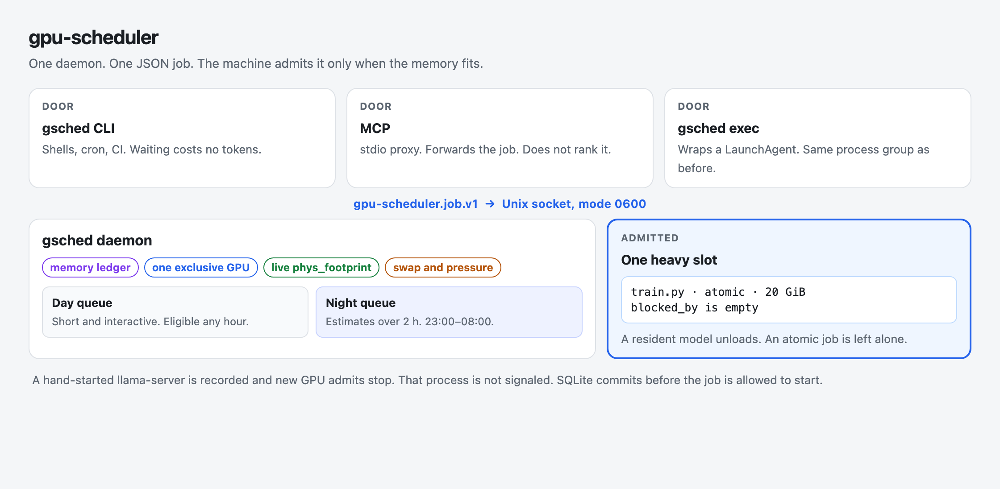
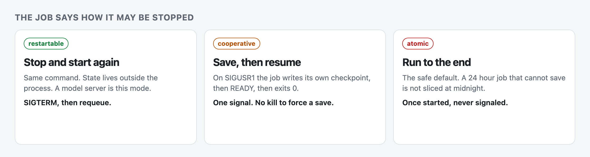

# gpu-scheduler

A local admission controller for **Apple silicon** unified memory. People, shell scripts, and coding agents submit a job. A small daemon, with no model inside it, decides when that job may start.

It is not an inference server and it does not sit on the OpenAI API. [GridCore](https://github.com/w512/GridCore), [sluice](https://github.com/zemo-g/sluice), and [mlx-serve](https://github.com/raspoli/mlx-serve) schedule requests against a model that is already loaded. `gpu-scheduler` schedules the processes themselves: a training run, a nightly eval, a `llama-server`, a vLLM experiment. Two of those can share the machine only when their memory reservations fit and the live sample agrees. Two GPU-heavy ones do not.

[](https://github.com/yekaiwu/gpu-scheduler/actions/workflows/ci.yml)
[](https://www.python.org/)
[](LICENSE)

Stdlib Python 3.12+. No third-party runtime dependencies. The policy is deterministic and tested with a fake clock.

<p align="center">
  
</p>

## The failure it exists to prevent

Apple silicon has one memory pool. CPU, GPU, and the OS spend the same bytes. There is no VRAM partition, and user space cannot freeze a Metal job and resume it later. Two programs that each looked small in Activity Monitor can push the machine into swap, and the OS answers real pressure by killing processes. `ps` RSS is the wrong instrument: a loaded model can show tens of megabytes of RSS while holding tens of gigabytes of `phys_footprint`.

Coding agents make this worse. Each session starts its own server because it cannot see the others. The scheduler is the shared view. It counts reservations, reads the live machine, and stops a job only in the way that job declared it can be stopped.

## What it does

- **Admits on memory, not on a free-percentage.** A job carries a GiB reservation. It starts only if the ledger and the live sample both have room. While it runs it counts as `max(reservation, footprint)`.
- **Keeps one exclusive GPU job.** `shared` jobs can overlap up to a configured cap. `gpu: none` runs beside either. The default is `exclusive`.
- **Separates the afternoon from the night.** Anything estimated over 2 hours goes to the night queue (23:00–08:00 local, configurable). An `atomic` job that cannot finish before morning does not start.
- **Refuses to invent a checkpoint.** `restartable` jobs can be stopped and started again. `cooperative` jobs save themselves on `SIGUSR1`. `atomic` jobs, the safe default, are never signaled once they have started.
- **Speaks one JSON document on three doors.** The `gsched` CLI, an optional MCP server, and a project file all submit `gpu-scheduler.job.v1`. The MCP server forwards that document. It does not rank jobs and it does not call a model.
- **Shows its reasons.** `gsched get` returns `blocked_by` and `why`. `gsched status --brief` and `gsched dashboard` show the budget, the queue, and the memory timeline.

## Why not the neighbouring tools

| Tool | What it is good at | Why this exists beside it |
|---|---|---|
| [GridCore](https://github.com/w512/GridCore) | Priority classes, measured VRAM, and model residency in front of llama.cpp, including Metal | It owns one inference runtime and the OpenAI API. A training script, a cron eval, and a hand-started vLLM are outside that. |
| [sluice](https://github.com/zemo-g/sluice) | A priority queue that serializes requests so two MLX servers do not overlap on Metal | The servers are already running. This project decides whether the process may start. |
| [mlx-serve](https://github.com/raspoli/mlx-serve), [llamactl](https://github.com/lordmathis/llamactl), Ollama | Load one model, unload it, expose an API | A model server is one kind of job here, a resident. The queue also holds everything else that wants the same RAM. |
| [Pueue](https://github.com/Nukesor/pueue), task-spooler | A solid queue of shell commands on one machine | Neither reads unified memory, nor distinguishes a job that can be killed from one that must run to the end. |
| A sentence in each agent's prompt | Cheap until the agent forgets, or a second tool starts the server | The check lives in the daemon. A foreign `llama-server` stops new GPU admits. The foreign process is not killed. |

The price of this shape: it will not route a chat completion, pick a model, or evict weights inside llama.cpp. Point a resident profile at the server you already trust, and let the scheduler decide when that server is allowed to be up.

## Install

Native arm64 Python 3.12+ on macOS 14 or newer. Rosetta is refused.

```sh
git clone https://github.com/yekaiwu/gpu-scheduler && cd gpu-scheduler
python3.12 -m gsched install            # venv + LaunchAgent under ~/.local/gpu-scheduler
export PATH="$HOME/.local/gpu-scheduler/bin:$PATH"
gsched doctor
gsched config set enforce true          # install leaves enforce off, on purpose
```

`gsched install` writes `enforce: false`. Until you turn enforcement on, `submit` only reports what would happen. Nothing is spawned.

`gsched install --venv-symlinks` builds the venv from symlinks, so the daemon runs the same interpreter you passed with `--python`. Use that when the interpreter already has Full Disk Access. `gsched doctor` prints the realpath to grant.

**Full Disk Access.** A LaunchAgent inherits macOS privacy controls (TCC). A job whose working directory is under `~/Documents`, `~/Desktop`, or `~/Downloads` fails unless the daemon's Python has Full Disk Access. Submit refuses that job up front with `cwd_not_accessible` and the same hint. Putting the job's code outside those folders avoids the grant.

Without the grant, `open()` and `chdir()` in those folders do not return an error. They block on a consent prompt nobody can answer. The daemon is single-threaded, so it never touches such a path itself. A short-lived probe (killed after 3 seconds, repeated every 10 minutes) learns whether each protected folder is readable. The job process is the one that enters its own working directory. Extra roots go in `tcc_protected_roots`.

## A first job

`--mem` and `--checkpoint` are required. The scheduler does not guess a size or a stop policy. `gsched suggest --project P --name N` proposes a memory size from earlier runs of the same name.

```sh
gsched run --project default --name hello \
  --mem 2 --gpu none --checkpoint atomic --est 1m --wait -- \
  python3 -c "print('hi')"

gsched logs <JOB_ID>
gsched get <JOB_ID>          # state, exit, and blocked_by + why while it waits
gsched status --brief
# 48.0 GiB machine · budget 40.0 · reserved 0.0 · live free 21.0 · GPU idle · pressure normal · 0 running · 0 queued · enforce on
```

`gsched wait`, `--wait`, and `logs --follow` block in a local process. They do not spend tokens.

## How a job is judged

Memory in the public API is always GiB (`2**30` bytes).

| Resource | Capacity | Rule |
|---|---|---|
| Memory | RAM minus an OS reserve, default `max(8 GiB, 12.5%)`. The live sample must agree. | A running job counts as `max(reservation, footprint)`. |
| GPU | One `exclusive` job, or up to `gpu_shared_max` `shared` jobs. `none` runs beside either. | Default is `exclusive`. |
| CPU | `cpu_budget` cores, default the physical core count. | A soft limit. |
| Locks | One holder per name. | A profile adds `port:<n>` for its listen port. |

### Checkpoint contract

<p align="center">
  
</p>

The mode is a claim about the program. The daemon only stops a job in the way that claim allows, and it never signals a process it did not spawn.

| Mode | The job claims | The daemon may | The daemon must not |
|---|---|---|---|
| `restartable` | It can be stopped and started again from the same argv. State is external or cheap to reload. | `SIGTERM` the process group, `SIGKILL` after 15 s, then requeue. | Call that a checkpoint. |
| `cooperative` | On `SIGUSR1` it writes `$GSCHED_CHECKPOINT_DIR`, writes `READY` last, and exits 0. On `GSCHED_RESUME=1` it resumes. | Send one `SIGUSR1`, and requeue the same job id after a valid `READY`. | `SIGTERM` or `SIGKILL` it to force a save. |
| `atomic` | It cannot save. This is the safe default. | Nothing, once it has started. | Send any signal on its own initiative. |

`examples/checkpoint_counter.py` is the reference cooperative worker. A failed, cancelled, or lost job stays finished. The only automatic requeue is a job the daemon itself stopped (`restartable`), a cooperative job that saved, or a job that never reached `exec`.

### Day, night, and a reserved window

A `day` job is eligible at any hour. `queue: auto` (the default) sends an estimate over 2 hours to the `night` queue, eligible from 23:00 to 08:00 local. An `atomic` night job that would still be running at the end of the window does not start (`blocked_by: fit_window`). Once per civil day, at the morning edge, cooperative night jobs get one checkpoint request. `examples/config/dedicated.json` turns the window off for a machine that only runs jobs. `examples/config/workstation.json` is the night window with no daytime backfill.

A reservation holds memory, and optionally the GPU, for one project during a weekly window, so a nightly pass is not crowded out by whatever else was running. Other projects are held back during the window, and also before it when their estimate says they would still be running when it opens (`blocked_by: reservation_window:<name>`). The owner project is unaffected. `unload_restartable` unloads other projects' restartable jobs once, at the window start.

```json
"reservations": [{
  "name": "nightly-pass",
  "days": ["mon", "tue", "wed", "thu", "fri"],
  "start": "19:00", "end": "23:30",
  "project": "example-train",
  "memory_gib": 27, "gpu": "exclusive",
  "unload_restartable": true
}]
```

`status` and the dashboard show active and upcoming windows. The full rule is in [`docs/implementation/16-exec-reservations-hardening.md`](docs/implementation/16-exec-reservations-hardening.md).

## Three ways in

**Shell and CI.** `gsched run` and `gsched submit` are the zero-token path.

**An existing LaunchAgent or cron line.** Put `gsched exec` in front of the command. The wrapper submits an external job, waits locally until it is admitted, then runs your command as its direct child in the same process group and session, so `launchctl bootout` still reaches it. The wrapper exits with the command's exact status.

```sh
gsched exec --project example-train --name nightly-eval \
  --mem 20 --gpu exclusive --checkpoint atomic --est 3h --max-wait 6h -- \
  python3 pipelines/eval.py --stage full
```

It is fail-open. If the daemon is down, still in observe mode, or refuses the request, the command is `exec`'d directly and a `gsched: exec fallback:` line on stderr says why. `--fail-closed` exits 75 instead. A signal while the job is still queued cancels it and does not run the command. `--max-wait` gives up on capacity and either runs the command (`--on-max-wait run`, the default when fail-open) or exits 75 (`fail`). The daemon never signals a wrapped command.

**Agents.** The MCP server is a stdio proxy. It holds no state and makes no decisions. Copy [`AGENTS.md`](AGENTS.md) into the repos those agents work in.

```json
{ "mcpServers": { "gpu-scheduler": { "command": "gsched", "args": ["mcp"] } } }
```

Claude Code, if `gsched` is not on the client's PATH:

```sh
claude mcp add gpu-scheduler -- ~/.local/gpu-scheduler/bin/gsched mcp
```

Tools: `submit_job`, `get_job` (`wait_s` up to 30), `list_jobs`, `cancel_job`, `get_job_logs`, `get_status`. MCP submission is off for a project until its project file sets `"mcp_submit": true`. Otherwise an agent that only has MCP tools could run arbitrary commands.

## A model server is a resident

A resident is a `restartable` job that stays up. Describe it under `$GSCHED_HOME/profiles/` and call `gsched ensure NAME`. The call returns immediately. The load happens on the daemon's turn.

```json
{
  "name": "llama",
  "project": "example-train",
  "spec": {
    "command": ["${LLM_ROOT}/start-llama.sh"],
    "cwd": "${LLM_ROOT}",
    "resources": {"memory_gib": 27, "gpu": "exclusive"},
    "priority": 10
  },
  "listen_port": 8081,
  "health_url": "http://127.0.0.1:8081/health",
  "slots_url": "http://127.0.0.1:8081/slots",
  "idle_unload_s": 1800
}
```

Put machine-specific values in `$GSCHED_HOME/env` (`LLM_ROOT=/path/to/models`). Leave `preempt_restartable` at `false` until you have rehearsed a handover on your machine. A worked example with placeholders is `examples/profiles/llama-server.example.json`.

## See the queue

`gsched dashboard` is an opt-in, read-only page: capacity, running jobs, the queue with reasons, recent results, and a memory timeline. It is a separate process on loopback, guarded by a token file, and it can call only the daemon's read methods. The daemon opens no TCP port.

```sh
gsched dashboard --print-url        # http://127.0.0.1:8765/?t=<token>
gsched dashboard --open
gsched install --dashboard          # LaunchAgent for the page
```

`gsched status --brief` is the same snapshot in one line.

## Configuration

`gsched config get` prints the effective config. `gsched config set KEY VALUE` validates before it writes. Every key, its default, and its check are in [`docs/implementation/01-repo-and-conventions.md`](docs/implementation/01-repo-and-conventions.md#7-config-reference).

Presets: [`examples/config/workstation.json`](examples/config/workstation.json) and [`examples/config/dedicated.json`](examples/config/dedicated.json).

### Quitting a desktop app to make room

Opt-in, and off unless you name the app. The scheduler quits it gracefully and reopens it with `open -g` once the memory is no longer needed.

```json
"yield_apps": [{
  "name": "terminal",
  "app": "/Applications/Some Data Terminal.app",
  "reservations": ["evening-pass"],
  "for_jobs_gib": 16,
  "busy_ports": [9001],
  "quit": "applescript",
  "reopen_delay_s": 60
}]
```

- `reservations`: quit while one of these windows is active.
- `for_jobs_gib`: or when a queued job of at least this many GiB has been blocked only by live memory for `job_wait_s` (60 s), and closing the app would let it fit.
- `busy_ports`: never quit while another process is connected to the app's local API.
- `quit`: `applescript` (default) or `sigterm` (graceful, for Electron and Chromium apps only).

There is no force-kill. If the app is still open after `quit_timeout_s` (a save dialog), it is left alone. If you reopen it yourself, it is not closed again for that episode. The scheduler reopens only apps it closed. `status` and the dashboard show a closed app. `applescript` needs a one-time Automation consent for the daemon's Python. `sigterm` needs none.

## What it will not do

These are enforced by tests.

- It never signals a process it did not start. IDEs, browsers, and launchd services have no signal path. A foreign `llama-server` makes the scheduler stop admitting new GPU work. It is not touched. The one exception is an app you listed in `yield_apps`: a graceful quit, never `SIGKILL`, and a reopen afterwards.
- It never signals an `atomic` job, or a cooperative job that failed to checkpoint, on its own initiative. Only `gsched cancel --terminate`, typed by you, can stop one.
- It commits to SQLite before it replies to a client or lets a job start.
- When a probe fails (swap unreadable, a layout check, an identity mismatch), it admits nothing new and signals nothing.
- Observe mode changes nothing: no row is inserted, nothing is spawned, nothing is signaled.

## Limits

Apple silicon only. One user: the socket is mode `0600`, and the peer must have the daemon's uid. There is no sandbox. The daemon refuses to oversubscribe. It does not contain a process that ignores it. The door a client reports (`cli`, `mcp`) is self-reported, so it is a policy hint, not a security boundary. The per-project MCP opt-in is what stops an agent that only has tools. `caffeinate` keeps the Mac awake for a running job. It cannot stop a laptop sleeping when the lid closes on battery.

## Further reading

| | |
|---|---|
| [`DESIGN.md`](DESIGN.md) | The design: admission, the three checkpoint modes, the two queues. |
| [`docs/implementation/`](docs/implementation/README.md) | Normative build notes. One file per subsystem. |
| [`docs/implementation/QUESTIONS.md`](docs/implementation/QUESTIONS.md) | Judgment calls, and why they went the way they did. |
| [`CONTRIBUTING.md`](CONTRIBUTING.md) | How to test a change. |
| [`LICENSE`](LICENSE) | Apache License 2.0. |
